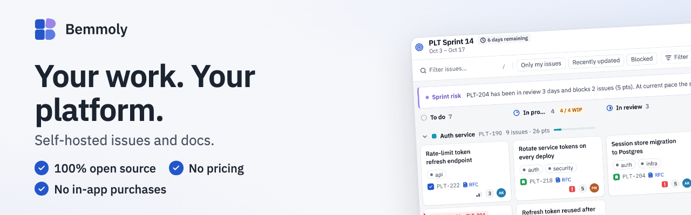
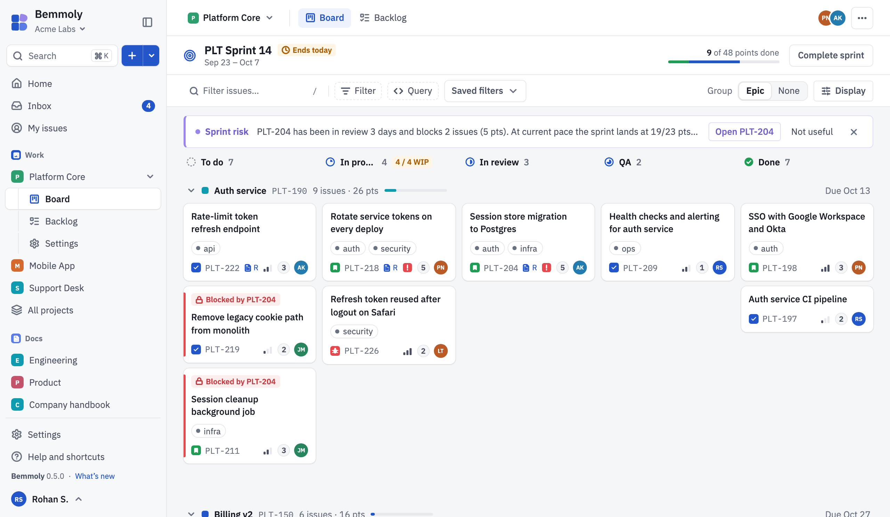
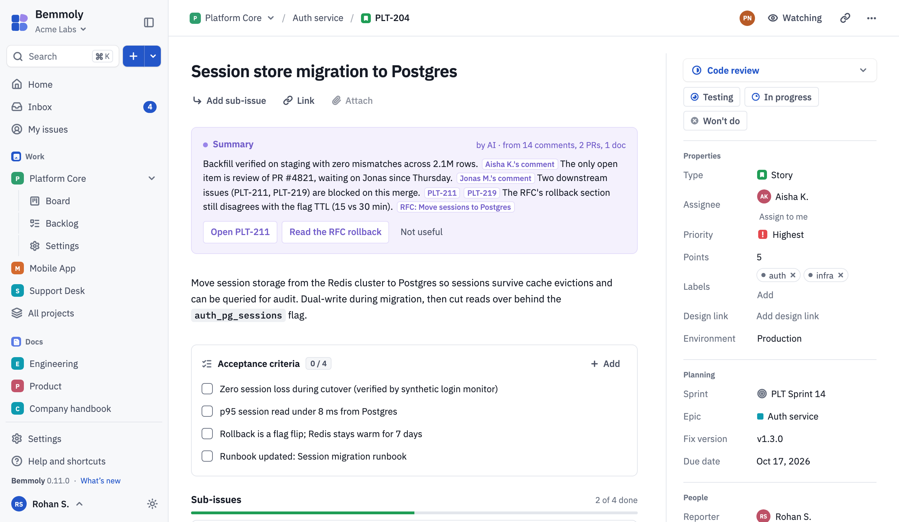
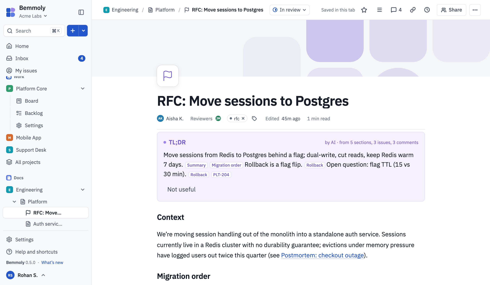

<p align="center">
  <picture>
    <source media="(prefers-color-scheme: dark)" srcset="./packages/ui/assets/brand/generated/readme-hero-ocean.png">
    
  </picture>
</p>

<p align="center"><strong>Your work. Your platform.</strong></p>

<p align="center">
  <a href="https://bemmoly.com/demo"><strong>Live demo</strong></a> ·
  <a href="https://bemmoly.com">Website</a> ·
  <a href="https://bemmoly.com/self-hosting#install">Install guide</a> ·
  <a href="https://bemmoly.com/changelog">Changelog</a> ·
  <a href="https://github.com/bemmoly/bemmoly/discussions">Discussions</a>
</p>

<p align="center">
  <a href="https://github.com/bemmoly/bemmoly/actions/workflows/ci.yml"></a>
  <a href="https://github.com/bemmoly/bemmoly/actions/workflows/security.yml"></a>
  <a href="./LICENSE"></a>
  <a href="https://github.com/bemmoly/bemmoly/releases/latest"></a>
  <a href="https://bemmoly.com/self-hosting#install"></a>
</p>

Bemmoly is self-hosted issues and docs for your whole team. Plan sprints on a board, write the
spec next to the issue it explains, and, if you want it, let AI summarise and answer from
everything your team has written. It all runs on your own server: your data stays in your
Postgres, behind your login, under your backups.

It is one app image and one Postgres, installed with one command and updated from inside the
app.

## Three promises

- **100% open source.** MIT licensed. Every feature is in this repository and in the image you
  install. There is no open core, no enterprise edition and no licence key.
- **No pricing.** No plans, no per-seat fee, no user limit. Your only cost is the server you
  run it on.
- **No in-app purchases.** Nothing in the app is locked or upsold. The Buy Me a Coffee button
  on this repository is an optional way to support the project, and it unlocks nothing.

## What ships in 0.7.0

- **Work**: projects with members, issues with types, custom fields and history, workflows with
  a visual editor, Kanban and Scrum boards, the backlog and sprints, LQL and saved filters, and
  "My work" on Home.
- **Docs**: spaces and a page tree, a live collaborative editor with named cursors, revisions,
  comments, images uploaded by paste, drop or the / menu, issue links that show live status,
  Markdown folder import, and export to Markdown and HTML.
- **Imports**: an admin opens Settings › Import (or the setup wizard's import step), picks Import
  from Jira, Import from Confluence or a CSV file, and sees what the site holds and how issue
  types, statuses and custom fields will land before anything is written. Jira Cloud and Data
  Center bring projects, issues, comments, attachments, boards and sprints into Work; Confluence
  Cloud, Data Center or a space export bring spaces, page trees, comments and attachments into
  Docs. The import runs in the background with live progress, can be cancelled, is safe to run
  again, and ends with a report of what was created, updated and skipped.
- **AI, optional**: off until an admin turns it on, and nothing changes for a workspace that
  leaves it off. Bring any provider in the [models.dev](https://models.dev) catalog, a gateway,
  or a model running on your own network. Then Bemmoly summarises issues, sprints and pages with
  the source of every claim, answers questions from your docs with citations, suggests and edits
  text in the doc editor, and turns a request in ⌘K into a plan of changes that runs only when
  you confirm it. Admins choose what content is sent, which spaces and projects are excluded,
  and a monthly budget.
- **Single sign-on and SCIM**: any OpenID Connect provider through its discovery URL, or SAML
  2.0 with signed assertions. People are created on first sign-in, linked by verified email and
  placed in roles and teams from their groups; an admin can require single sign-on for everyone,
  with break-glass admins kept. SCIM 2.0 at `/scim/v2` creates, updates and deactivates people
  and keeps teams in step, with an audit row for every change.
- **An MCP server**: point an AI desktop app, coding agent or IDE at `/mcp` (or `/mcp/work`,
  `/mcp/docs`) and it works in your workspace as you, with your permissions, rate limited and in
  the audit log.
- **The platform under them**: a setup wizard, people, roles and a capability matrix, email
  and notifications, an Inbox, ⌘K search, an audit log, Prometheus metrics, automatic HTTPS,
  nightly verified backups, and one-click updates with automatic rollback.

Work and Docs ship in every install; an admin turns modules on in Settings › Modules. See the
[changelog](https://bemmoly.com/changelog) for every release.

## Try it

**In your browser, no install:** [bemmoly.com/demo](https://bemmoly.com/demo) runs the real app
on sample data, entirely in your browser, with AI on. Nothing is sent anywhere and a reload
starts over.

**On your own server:** on a fresh Linux VM with a domain pointing at it, run

```sh
curl -fsSL https://get.bemmoly.com | sh
```

About five minutes later the installer prints your address; open it to create the first admin.
Prefer to read it first? `curl -fsSL https://get.bemmoly.com -o install.sh && less install.sh`.

You need a VM with at least 1 vCPU and 2 GB of memory (2 vCPU and 4 GB for about 200 people),
root or sudo, 10 GB of free disk, ports 80 and 443, and a domain pointing at the VM. Ubuntu is
the main target; the installer also supports Debian, Fedora and Amazon Linux. It sets up Docker, Postgres, HTTPS, backups and updates, checks
the requirements itself and prints the fix for anything missing. Docker Compose by hand and an
existing Postgres are covered at [bemmoly.com/self-hosting](https://bemmoly.com/self-hosting#install).

## Screenshots

From the [live demo](https://bemmoly.com/demo), in the light and dark themes.

<picture>
  <source media="(prefers-color-scheme: dark)" srcset="./apps/site/src/assets/previews/board-dark.png">
  
</picture>

<picture>
  <source media="(prefers-color-scheme: dark)" srcset="./apps/site/src/assets/previews/issue-dark.png">
  
</picture>

<picture>
  <source media="(prefers-color-scheme: dark)" srcset="./apps/site/src/assets/previews/docs-dark.png">
  
</picture>

## Status: young, and honest about it

Bemmoly is new. 0.1.0 shipped in October 2026 and releases come quickly. Before 1.0, a minor
version may change behaviour and its notes say so; every update backs up first and rolls back
on its own if the app is not healthy. Run it for real work if you like, and keep the nightly
backups it makes.

| Released | Scope                                                                                 |
| -------- | ------------------------------------------------------------------------------------- |
| 0.2      | **Work**: projects, issues, workflows, boards, backlog and sprints, filters           |
| 0.3      | **Docs**: spaces, the page tree, a collaborative editor, revisions, comments          |
| 0.4      | **The redesign**: one shell for Work and Docs, the logo's colours, drawn icons        |
| 0.5      | **AI, optional**: summaries with sources, answers from your docs, editor and ⌘K plans |
| 0.6      | **Image uploads** in Docs, an **MCP server**, and an updater that updates itself      |
| 0.7      | **Imports** from Jira, Confluence and CSV, and **single sign-on** with SCIM           |

**Coming soon**, not in the app yet:

- Webhooks and automation rules
- A roadmap view: epics on a timeline
- Kubernetes (a supported Helm chart) and Terraform modules for AWS, GCP and Hetzner
- A tested offline (air-gapped) install, a PWA, and an accessibility and security review
  before 1.0

The plan for each release is in section 24 of the [technical design](docs/tech-design.html).

## Privacy

- **The product sends nothing to us.** There is no telemetry. The daily check for new
  releases is off until an admin turns it on in Settings, and then it only downloads the
  release manifest from GitHub. With AI off, the server makes no AI-related request to anyone.
  Everything else that leaves your server is what you configure: your mail server, a backup
  bucket, your AI provider, the certificate authority for HTTPS, and a tracing collector of
  your own.
- **The website and the demo collect nothing.** bemmoly.com serves no analytics, no cookies
  and no third-party scripts (its Content-Security-Policy allows only its own files), and the
  demo keeps its sample data in your browser's memory.

## Architecture

A TypeScript monorepo: a Fastify host boots the kernel (identity, permissions, settings,
notifications, jobs, realtime, search, the AI runtime) and loads each enabled module, and a
React shell loads one chunk per module. Postgres is the only datastore, holding the data, the
job queue, full-text search and vector embeddings. Modules talk to each other only through
kernel registries and events, so each can be turned off without breaking the rest.

- Technical design: [docs/tech-design.html](docs/tech-design.html) (open in a browser)
- Design system: [docs/design/system](docs/design/system/README.md)
- Decisions since the design: [docs/adr](docs/adr)

## Contributing

Contributions are welcome, from people and from AI agents alike. Start with
[CONTRIBUTING.md](CONTRIBUTING.md), which points at good first issues, and
[AGENTS.md](AGENTS.md), the contract for every change. You need Node 24, pnpm 11 and Docker:

```sh
nvm use            # Node 24, from .nvmrc
corepack enable    # or install pnpm 11
pnpm i
pnpm dev           # Postgres 18 in Docker, server on :8080, web on :5173
```

Open http://localhost:5173. A devcontainer (and Codespaces) has all of it ready.

## Help and security

- Questions and ideas: [Discussions](https://github.com/bemmoly/bemmoly/discussions); bugs:
  [issues](https://github.com/bemmoly/bemmoly/issues/new/choose). [SUPPORT.md](SUPPORT.md)
  says what goes where.
- Security problems: privately, through
  [GitHub's private vulnerability reporting](https://github.com/bemmoly/bemmoly/security/advisories/new),
  as [SECURITY.md](SECURITY.md) describes. Please do not open a public issue.
- Everyone taking part follows the [Code of Conduct](CODE_OF_CONDUCT.md).

## Licence

[MIT](LICENSE). Free to use, change and self-host, for any number of people, forever.
